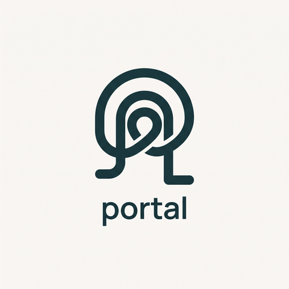

<p align="center">
  
</p>

# Portal

Send files and folders directly between two machines: peer-to-peer,
end-to-end encrypted, resumable, and simple to use.

```console
# Machine A
$ portal send ./project
Code: 4821937-cedar-river
Waiting for receiver...

# Machine B
$ portal receive 4821937-cedar-river
Receiving "project" (1,284 files, 2.3 GB) from 192.168.1.20 [direct]
[████████████░░░░░░░░] 61%  48 MB/s  ETA 0:19
```

> **Status:** early development. Transfers work end to end with short
> codes, with no server to set up, and pick up where they left off when
> interrupted.

## Try it

```console
# Machine A
$ portal send ./project
Sending "project" (2 files, 5.00 MB)
Code: 4821937-baker-hazy

On the other machine, run:

  portal receive 4821937-baker-hazy

# Machine B
$ portal receive 4821937-baker-hazy
Receiving "project" (2 files, 5.00 MB) from 192.168.1.20 [direct]
Save it into C:\Users\you\Downloads? [Y/n]
✓ Received 2 files, 5.00 MB into C:\Users\you\Downloads in 0.4s (12.50 MB/s)
```

`portal receive` asks before saving anything; `--yes` skips the question
(it is never asked when the input is not a terminal, e.g. in scripts).

Received files go into the current folder. To always save them somewhere
else, set a download folder once (`portal dir` shows it, `portal dir --reset`
forgets it), or pick one for a single transfer with `--output`:

```console
$ portal dir ~/Downloads
✓ Received files will be saved into /home/you/Downloads
$ portal receive 4821937-baker-hazy --output ./elsewhere
```

If a transfer is interrupted, just run it again: the sender runs
`portal send` with the same files, and only what is still missing crosses
the network. Files the receiver already has with exactly the same content
are skipped as well, so receiving a folder twice is not a conflict.

The receiver finds the sender by the number at the start of the code: on
the same network through mDNS (instant, works offline), anywhere else
through the public BitTorrent DHT (a few seconds). Neither ever sees the
words or the files. Each code works once: a wrong guess cancels the
transfer, so nobody gets a second try.

If your network blocks this (some corporate networks block outgoing UDP),
you can pair through a [rendezvous server](docs/SELF_HOSTING.md) you run
yourself instead, with `--rendezvous wss://…/v1` or `PORTAL_RENDEZVOUS`.
`portal doctor` checks what works on the network you are on.

### Several files, text and the clipboard

```console
$ portal send report.pdf photos/ notes.txt     # one transfer, one code
$ portal send --text "https://example.com/meeting"
$ portal send --clipboard                      # whatever text you copied
$ some-command | portal send --text -          # text from a pipe
```

The receiver runs `portal receive <code>` as usual. Text is printed, or with
`--copy` put on the receiver's clipboard instead (handy for passwords).

### Your own devices, without a code

Pair two machines once:

```console
desk$   portal pair
Pairing code: 3318472-oak-lemon
laptop$ portal pair 3318472-oak-lemon
✓ Paired with desk. This device is "laptop" to it.
```

From then on, no codes:

```console
desk$   portal send ./project --to laptop
laptop$ portal receive --from desk
```

`portal devices` lists paired devices and `portal unpair <name>` forgets one.
The receiver is still asked before anything is saved.

### Right-click "Send with Portal"

```console
portal context-menu            # add it (the Windows installer already did)
portal context-menu --remove   # take it away
```

On Windows it appears for files and folders (on Windows 11 under "Show more
options"), and "Send to → Portal" sends several selected items at once. On
macOS it is a Finder Quick Action; on Linux, a Nautilus script and a Dolphin
service menu. A terminal window opens with the code and stays until the
transfer is done. (The macOS and Linux versions are new and less tested than
the Windows one.)

### Speed limit

```console
portal send big.iso --limit 5MB/s
portal receive 4821937-cedar-river --limit 500k
```

### Updating

```console
portal update           # installs the newest release
portal update --check   # only says whether there is one
```

When Portal came from a package manager, use that instead; `portal update`
tells you which.

## Goals

- One command on each side. No accounts, no config, no port forwarding, no server to run.
- End-to-end encrypted: relays and the rendezvous server never see contents or keys.
- Direct peer-to-peer when possible (QUIC + hole punching), encrypted relay as fallback.
- Resumable and verified: every byte is BLAKE3-checked.
- Content-defined chunking, so re-sending a changed folder only sends what changed.
- Windows, macOS and Linux.

## Shell completions

```console
portal completions powershell >> $PROFILE                                    # PowerShell
portal completions bash > ~/.local/share/bash-completion/completions/portal  # Bash
portal completions zsh > ~/.zfunc/_portal                                    # Zsh
portal completions fish > ~/.config/fish/completions/portal.fish             # fish
```

## Installing

Windows (PowerShell):

```console
irm https://raw.githubusercontent.com/MStefa003/portal/main/install.ps1 | iex
```

macOS and Linux:

```console
curl -fsSL https://raw.githubusercontent.com/MStefa003/portal/main/install.sh | sh
```

Both scripts check the download's SHA-256 before installing. The Windows
one also adds "Send with Portal" to the right-click menu (set
`PORTAL_NO_CONTEXT_MENU=1` first to skip that).

With a package manager:

```console
scoop bucket add portal https://github.com/MStefa003/portal; scoop install portal   # Windows
brew tap mstefa003/portal https://github.com/MStefa003/portal; brew install portal  # macOS, Linux
cargo binstall --git https://github.com/MStefa003/portal portal-cli                 # anywhere
```

Or download an archive from the [Releases](https://github.com/MStefa003/portal/releases)
page. Every archive has a SHA-256 file and a build provenance attestation:
`gh attestation verify <archive> --repo MStefa003/portal` proves it was built
by this repository's release workflow.

## Uninstalling

Windows (PowerShell):

```console
irm https://raw.githubusercontent.com/MStefa003/portal/main/uninstall.ps1 | iex
```

macOS and Linux:

```console
curl -fsSL https://raw.githubusercontent.com/MStefa003/portal/main/uninstall.sh | sh
```

This removes Portal and its right-click menu entries; files you sent or
received stay where they are, and so do your settings and paired devices.

## Building

```console
cargo build --release
```

Releases are built by `.github/workflows/release.yml` when a `v*` tag is
pushed; see [docs/RELEASING.md](docs/RELEASING.md), which also covers code
signing and the package managers.

On Windows you need the MSVC toolchain ("Build Tools for Visual Studio" with
the *Desktop development with C++* workload). If you build from Git Bash and
see `link: extra operand`, Git's coreutils `link` is shadowing MSVC's
`link.exe`: build from PowerShell or a Developer Command Prompt instead.

## Workspace

| Crate | Responsibility |
|---|---|
| `portal-core` | Chunking, manifests, hashing, transfer state machine, resume |
| `portal-proto` | Wire protocol: message types, versioning, serialization |
| `portal-net` | iroh/QUIC connections, PAKE handshake, mDNS/DHT discovery, rendezvous client |
| `portal-cli` | The `portal` binary |
| `portal-rendezvous` | Optional self-hostable server that pairs peers by short code |

See [docs/ARCHITECTURE.md](docs/ARCHITECTURE.md), [docs/PROTOCOL.md](docs/PROTOCOL.md)
and [docs/SELF_HOSTING.md](docs/SELF_HOSTING.md).

## License

Licensed under either of [Apache License, Version 2.0](LICENSE-APACHE) or
[MIT license](LICENSE-MIT) at your option.

Unless you explicitly state otherwise, any contribution intentionally submitted
for inclusion in this project by you, as defined in the Apache-2.0 license,
shall be dual licensed as above, without any additional terms or conditions.

Code words come from the [EFF Short Wordlist #1](https://www.eff.org/dice)
by the Electronic Frontier Foundation, licensed under
[CC BY 3.0 US](https://creativecommons.org/licenses/by/3.0/us/) (one word
removed). See [NOTICE](NOTICE).
